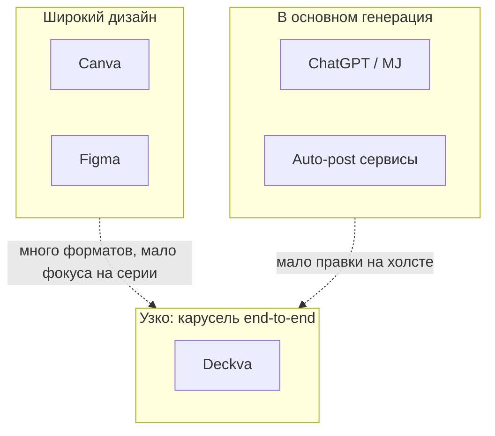
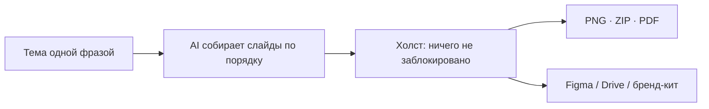

# Чем Deckva отличается от других

## Короткий ответ

Deckva — не «ещё один редактор картинок» и не «чат с ИИ». Это студия **именно каруселей**: одна тема → набор слайдов в нужном порядке → правка на холсте → готовый файл для поста.

## Карта ниши

## Сравнение «по делу»

| | Canva / Figma | ChatGPT / Midjourney | Auto-post сервисы | **Deckva** |
| --- | --- | --- | --- | --- |
| Фокус | Любой дизайн | Текст / картинка | Расписание + шаблоны | **Карусель как единица работы** |
| Старт | Пустой холст / шаблон | Промпт | Тема → готовый пост | **Тема → слайды → правка** |
| Правка после AI | Сильная, но широкая | Слабая / новый промпт | Часто «как есть» | **Холст: текст, обложка, порядок** |
| Экспорт | Много форматов | Картинки по одной | Публикация в соцсеть | **PNG / ZIP / PDF под пост** |
| Бренд | Киты, команды | Почти нет | Частично | **Бренд-кит, папки, org** |
| Figma | Сама Figma | Нет | Редко | **Импорт / экспорт фреймов** |

## Что отличает именно сейчас

1. **Единица продукта — карусель**, не «документ» и не «чат».
2. **Полный цикл в одном месте**: идея → генерация → правка → файл без водяных знаков.
3. **Редактор после AI обязателен**: генерация — старт, не финал.
4. **Форматы соцсетей из коробки**: Insta 4:5, TikTok 9:16, Threads, LinkedIn.
5. **Студийный слой**: бренд-кит, community/шаблоны, организации, коннекторы — ближе к Miro/студии, чем к одноразовому генератору.
6. **Сейчас бесплатно** с дневным лимитом генераций (редактирование и скачивание не считаются) — порог входа ниже, чем у Pro-конструкторов.

## Чем мы сознательно *не* являемся

- Не замена Figma для продуктового UI.
- Не планировщик постинга и аналитики аккаунта (пока).
- Не мобильный «сделай пост за 10 секунд без правки» — студия рассчитана на большой экран.

## Вывод для позиционирования

> «Карусель из одной фразы — и сразу правите, как в студии, а не перегенерируете в чате.»
