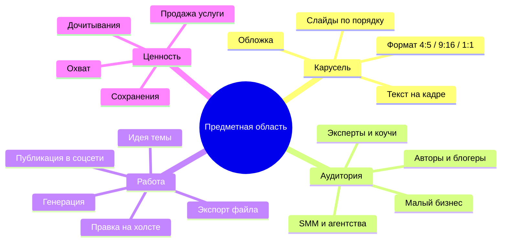
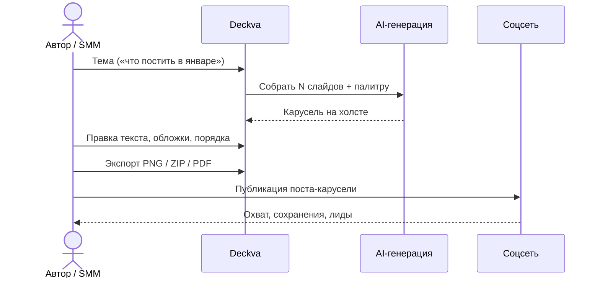
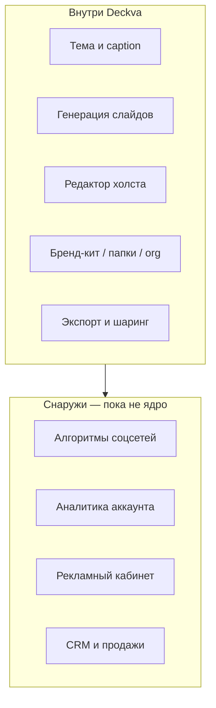
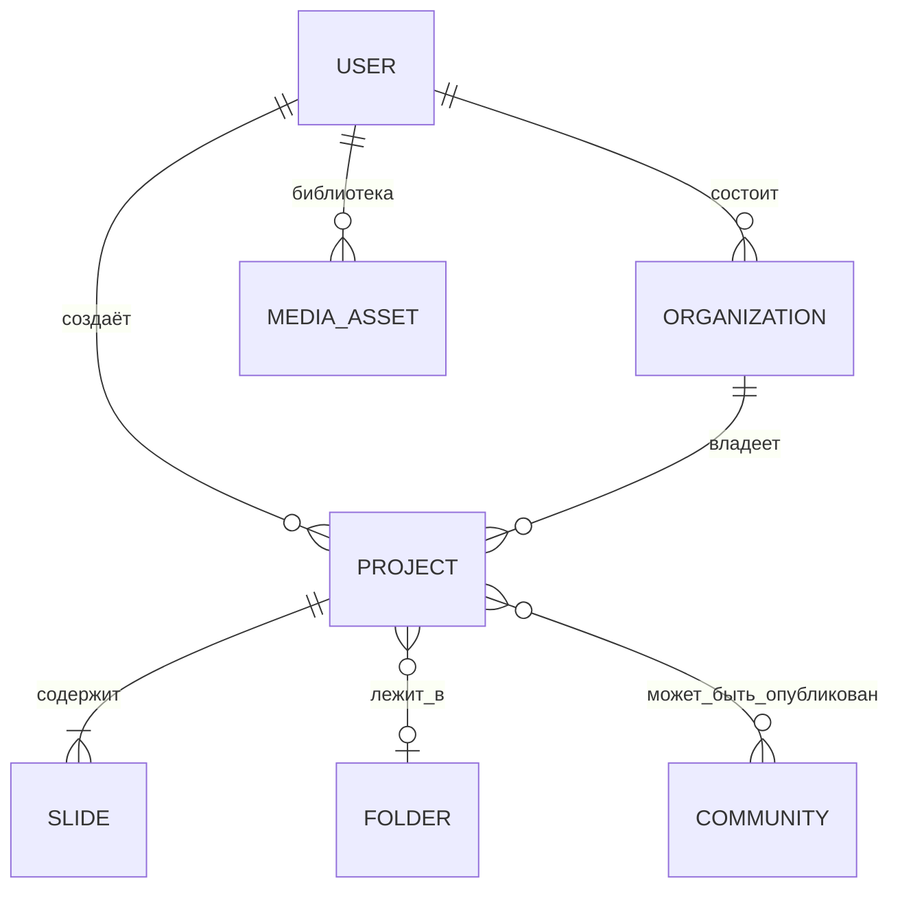

# Предметная область Deckva

## Что это за мир

Deckva живёт на стыке **контент-маркетинга** и **визуального дизайна коротких форматов**. Главный артефакт — **карусель**: серия слайдов, которую листают в Instagram, Threads, TikTok, LinkedIn и похожих лентах.

## Объект работы: карусель

| Понятие | Смысл в Deckva |
| --- | --- |
| **Проект** | Одна карусель: слайды, порядок, холст, превью |
| **Слайд** | Один кадр (снимок Fabric-холста) |
| **Тема / промпт** | Seed для AI-генерации |
| **Палитра / бренд-кит** | Цвета и стили, которые «держат» серию |
| **Экспорт** | PNG (кадр), ZIP (вся серия), PDF |
| **Community** | Публичные шаблоны / примеры для переиспользования |

## Типичный сценарий

## Зачем карусели нужны рынку

1. **Лента награждает серии** — дольше смотрят, чаще сохраняют.
2. **Экспертный контент** удобно дробить: миф → факт → шаг → CTA.
3. **Визуал + текст** работают лучше длинного поста без структуры.
4. **Пакет кадров** проще готовить один раз, чем каждый пост с нуля.

## Границы предметной области

Deckva отвечает за **создание и подготовку** карусели. Публикация, алгоритмы и продажи — соседние зоны: продукт к ним стыкуется (форматы, insights, коннекторы), но не подменяет соцсеть.

## Ключевые сущности продукта (как в системе)

## Язык ценности (для лендинга и продаж)

- Не «нейросеть нарисует картинку».
- А **«из темы — готовая серия кадров, которую вы доводите до поста»**.
