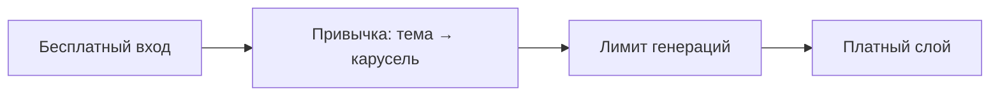
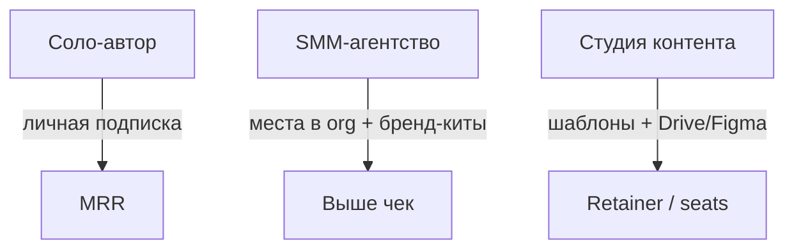
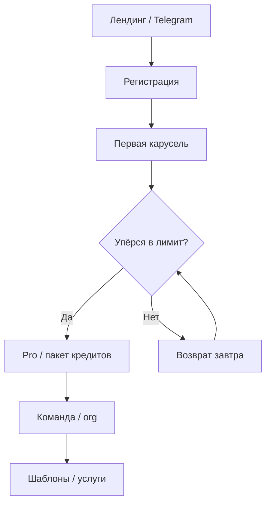
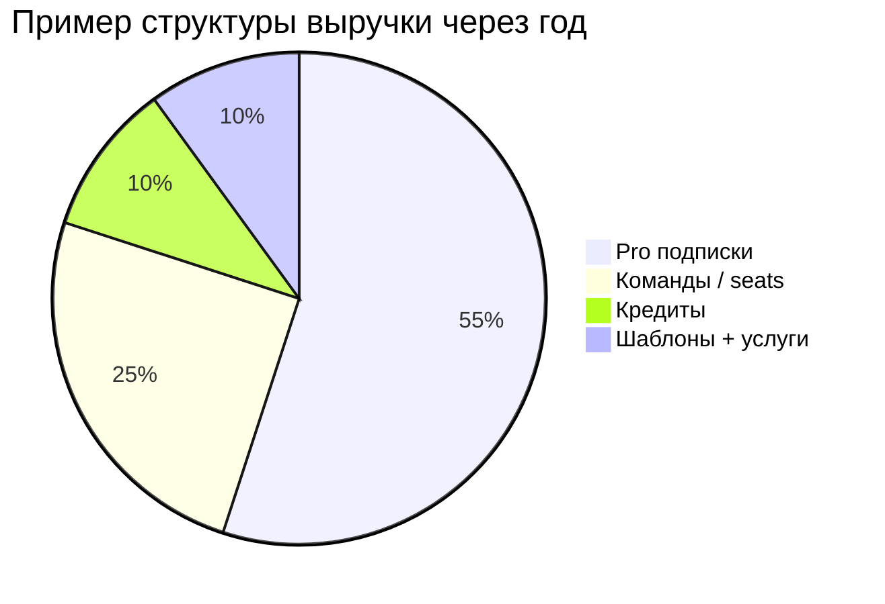

# Как заработать с проекта Deckva

## Сейчас

Продукт **бесплатный**: дневной лимит генераций на аккаунт, правка и экспорт без списаний. Это фаза роста аудитории, не отказ от денег.

Юридический контур уже намечен в продукте: **плательщик НПД, Республика Беларусь** — удобно для B2C/фриланс-модели и ранних подписок.

## Главные модели денег

### 1. Freemium-подписка (базовая ставка)

Самый естественный путь: платят за **больше генераций** и **лучшие модели**, а не за сам редактор.

| | Free | Pro (пример) |
| --- | --- | --- |
| Генерации / день | 15 (как сейчас) | 100+ или пакеты |
| AI-модели | Базовые | Premium-модели |
| Экспорт | PNG / ZIP / PDF | То же + приоритет |
| Бренд-кит / папки | Да | Да + больше места |
| Команда | 1 человек | Org / места в команде |

**Почему сработает:** стоимость AI — основной расход; лимит уже встроен в продукт.

### 2. Команды и агентства

Продаёте не «нейросеть», а **скорость выдачи каруселей клиентам**: общий бренд-кит, папки, инвайты в организацию.

### 3. Кредиты / пакеты генераций

Разовый апселл без годовой подписки: «50 генераций» для пика (релиз, марафон контента). Хорошо стыкуется с дневным лимитом.

### 4. Marketplace шаблонов

Community уже есть в модели продукта. Дальше:

- авторы выкладывают шаблоны;
- Deckva берёт комиссию;
- покупатель получает готовый стиль карусели.

### 5. Услуги вокруг продукта (быстрые деньги)

Пока MRR растёт — можно зарабатывать руками:

| Оффер | Кому | Суть |
| --- | --- | --- |
| Пакет «10 каруселей» | Эксперты | Вы / команда делают в Deckva |
| Настройка бренд-кита | Бизнес | Цвета, лого, шаблоны ниши |
| Обучение / воркшоп | SMM-команды | «Карусель за 15 минут» |
| White-label / кастом | Крупные клиенты | Отдельный инстанс / домен |

## Воронка денег

## Что *не* стоит монетизировать в первую очередь

- Водяные знаки на экспорте — убивают доверие (сейчас их нет осознанно).
- Плату за «просто скачать PNG» — ценность в генерациях и скорости цикла.
- Сложную рекламную платформу до того, как есть стабильный Pro.

## Практичный порядок запуска

1. Оставить Free + дневной лимит.
2. Включить **Pro: больше генераций + premium-модели**.
3. Добавить **seats для организаций**.
4. Параллельно — услуги и шаблоны для кэша.
5. Marketplace — когда community уже живой.

## Ориентир по цифрам (грубо)

Точные цены лучше ставить после того, как видно: сколько генераций реально жгут power-users и сколько команд уже заводят org.
