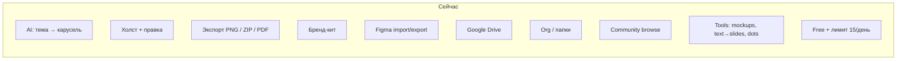
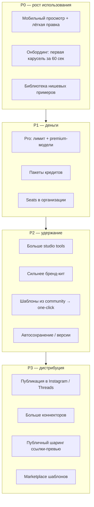
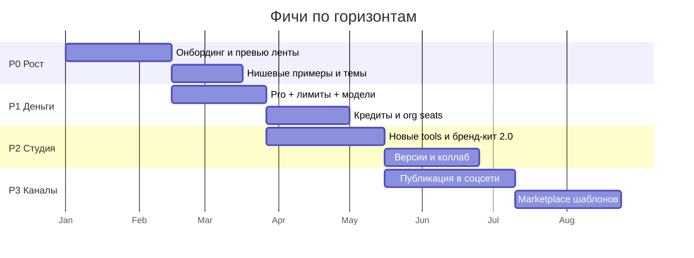
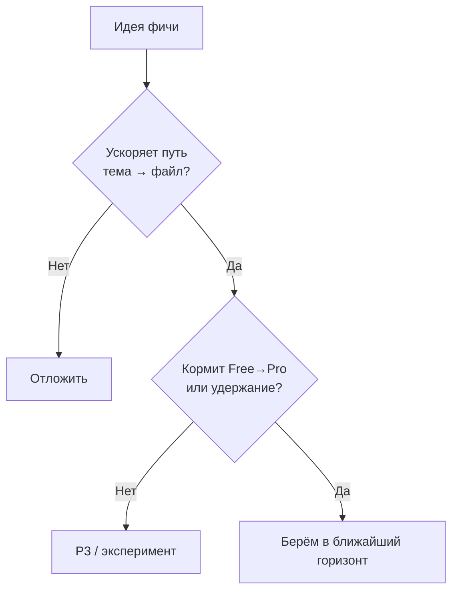

# Роадмап Deckva в фичах

Роадмап завязан на то, что уже есть в продукте, и на пробелы, которые мешают росту и деньгам. Горизонты — по ценности, не по календарю.

## Сейчас (уже в продукте)

## Карта приоритетов

## Backlog по фичам

### P0 — чтобы чаще возвращались

| Фича | Зачем |
| --- | --- |
| Улучшенный онбординг «тема → сразу редактор» | Снижает отвал до первой карусели |
| Каталог готовых тем по нишам | Эксперт / блогер не думает «о чём писать» |
| Превью карусели как в ленте (свайп) | Понятный критерий «готово» |
| История генераций / повтор темы | Быстрый реюз удачных промптов |
| Подсказки длины текста под платформу | Уже есть зачатки insights — довести до UX |

### P1 — монетизация

| Фича | Зачем |
| --- | --- |
| Тариф Pro (лимит генераций, модели) | Основной MRR |
| Покупка пакетов генераций | Разовые пики без подписки |
| Биллинг seats / org | Агентства платят больше |
| Админ-метрики расхода AI | Контроль маржи |
| Paywall только на генерации | Редактор и экспорт остаются «свободными» |

### P2 — глубина студии

| Фича | Зачем |
| --- | --- |
| Новые tools (обложки, CTA-блоки, таблицы, цитаты) | Расширяет «студийность» |
| Бренд-кит: шрифты, лого, пресеты chrome | Серийный контент без рассинхрона |
| Версии проекта / undo cloud | Спокойствие для длинных правок |
| Коллаб в org (комменты / роли) | Командная работа |
| Batch: N каруселей из одного брифа | Скорость для агентств |

### P3 — выход в каналы

| Фича | Зачем |
| --- | --- |
| OAuth-публикация в Instagram / Threads | Меньше ручного «скачал → загрузил» |
| Больше коннекторов (Dropbox, Notion assets) | Ассеты рядом с холстом |
| Публичная страница карусели + embed | Виральность и SEO |
| Marketplace шаблонов с комиссией | Второй контур выручки |
| Лёгкий mobile editor | Не только desktop |

## Roadmap-лента (условно)

Даты условные — сдвигайте под ресурс команды; порядок горизонтов важнее дат.

## Принцип отбора фич

## «Северная звезда» продукта

> За N минут автор получает **серию кадров под выбранную платформу**, правит её на холсте и уходит с файлом (или сразу публикует) — без ухода в Canva/Figma «с нуля».

Каждая фича в роадмапе должна либо **сокращать это время**, либо **увеличивать число таких циклов в день** (лимит → Pro), либо **включать команду** (org).
